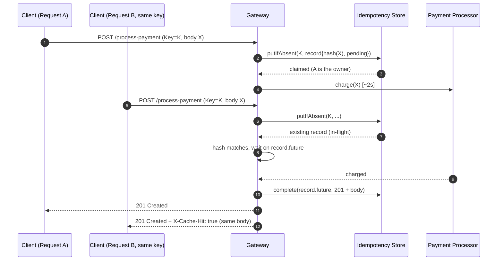
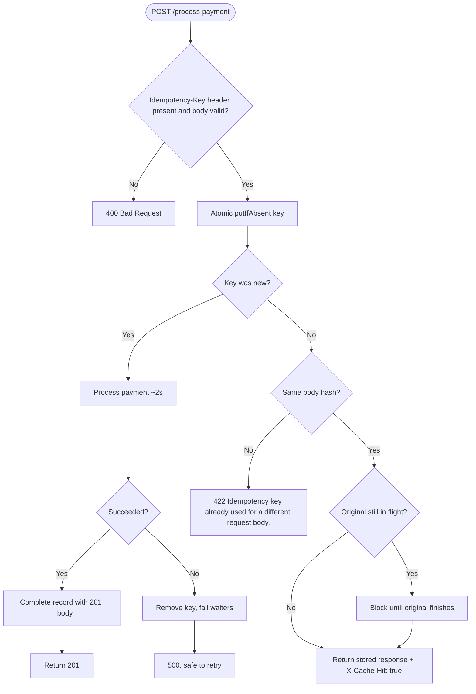

# Idempotency Gateway — the "Pay-Once" Protocol

A Spring Boot service for **FinSafe Transactions Ltd.** that guarantees a payment request is processed **exactly once**, no matter how many times the client retries it.

Clients send a unique `Idempotency-Key` header with each payment. The first request is processed and its response stored. Any retry with the same key gets the stored response back instantly, without charging again.

---

## Architecture

### Sequence diagram



### Flowchart



---

## Setup

**Requirements:** Java 17+ and Maven 3.6+.

```bash
git clone <your-fork-url>
cd idempotency-gateway

# run
mvn spring-boot:run

# or build a jar
mvn clean package
java -jar target/idempotency-gateway-1.0.0.jar

# run tests
mvn test
```

The server starts on **http://localhost:8080**.

### Configuration (`src/main/resources/application.properties`)

| Property | Default | Meaning |
|---|---|---|
| `server.port` | `8080` | HTTP port |
| `payment.processing-delay-ms` | `2000` | Simulated payment latency |
| `idempotency.ttl-seconds` | `86400` | How long a key is remembered (24h) |
| `idempotency.cleanup-interval-ms` | `60000` | How often expired keys are swept |

---

## API Documentation

### `POST /process-payment`

| | |
|---|---|
| **Header** | `Idempotency-Key: <unique string>` (required, max 255 chars) |
| **Header** | `Content-Type: application/json` |
| **Body** | `{"amount": <number >= 0.01>, "currency": "<3-letter code>"}` |

#### 1. First request (happy path)

```bash
curl -i -X POST http://localhost:8080/process-payment \
  -H "Content-Type: application/json" \
  -H "Idempotency-Key: order-1001" \
  -d '{"amount": 100, "currency": "GHS"}'
```

Takes about 2 seconds:

```
HTTP/1.1 201
Content-Type: application/json

{"status":"Charged 100 GHS","transactionId":"6f1c...","amount":"100","currency":"GHS"}
```

#### 2. Duplicate request (replay)

Run the same command again. It returns immediately with the identical status and body, plus:

```
HTTP/1.1 201
X-Cache-Hit: true

{"status":"Charged 100 GHS","transactionId":"6f1c...","amount":"100","currency":"GHS"}
```

The `transactionId` is the same as the first response, which proves nothing was re-processed.

#### 3. Same key, different body

```bash
curl -i -X POST http://localhost:8080/process-payment \
  -H "Content-Type: application/json" \
  -H "Idempotency-Key: order-1001" \
  -d '{"amount": 500, "currency": "GHS"}'
```

```
HTTP/1.1 422
{"error":"Idempotency key already used for a different request body."}
```

#### 4. In-flight duplicates (bonus)

Fire two identical requests at the same time:

```bash
for i in 1 2; do
  curl -s -i -X POST http://localhost:8080/process-payment \
    -H "Content-Type: application/json" -H "Idempotency-Key: order-2002" \
    -d '{"amount": 75, "currency": "USD"}' &
done; wait
```

Both return `201` after about 2 seconds (not 4). They share the same `transactionId`, and only the second carries `X-Cache-Hit: true`.

#### Error responses

| Status | When |
|---|---|
| `400` | Missing/blank `Idempotency-Key`, malformed JSON, or invalid `amount`/`currency` |
| `422` | Key reused with a different request body |
| `500` | Processing failed. The key is released, so retrying with the same key is safe |

### `GET /health`
Returns `{"status":"UP"}`.

---

## Design Decisions

- **Atomic claim with `ConcurrentHashMap.putIfAbsent`.** The first thread to insert a key becomes its owner. Every other thread sees the existing record. This removes the check-then-act race, so there is no explicit locking.
- **`CompletableFuture` per key for in-flight handling.** The owner completes the future when the payment finishes. Duplicates that arrive mid-flight call `future.get()` and block, then return the same result. They never start new work and never get a 409.
- **Body fingerprint (SHA-256 of a canonical form).** The fingerprint is computed from the *parsed* request (`amount` normalised via `stripTrailingZeros`, currency upper-cased), not the raw bytes. So `100` vs `100.00`, whitespace and key order don't trigger false conflicts, while a real change like 100 → 500 does.
- **422 for key reuse.** The request is well-formed but semantically unacceptable, which fits 422 better than 409.
- **Failures aren't cached.** If processing throws, the key is removed so the client can retry. Caching a failed charge forever would make the payment impossible to complete.
- **In-memory store.** The brief allows it, and it keeps setup to a single command. The `IdempotencyService` is the only class that touches the store, so swapping in Redis (`SET key NX` plus a pub/sub or polling wait) is a contained change. See *Limitations*.
- **Replays return the original status code and body**, with `X-Cache-Hit: true` added.

---

## Developer's Choice: Key Expiry (TTL) with Automatic Eviction

**What:** Every idempotency record has a time-to-live (default 24h, configurable). A scheduled job (`IdempotencyService.evictExpired`) periodically removes completed records older than the TTL. In-flight records are never evicted.

**Why:** In a payments system, the idempotency store sits on the hot path of every transaction. Without expiry:

1. **Memory grows without bound.** Every payment ever made stays in the map until the service falls over.
2. **Keys are retry-scoped, not forever-scoped.** Retries happen within seconds or hours. After a day, a reused key is almost certainly a client bug, and 24h is the window used by well-known payment APIs such as Stripe.

The TTL is a property (`idempotency.ttl-seconds`), so operations can tune it without a code change.

---

## Limitations / Next Steps

- The store is **in-memory and per-instance**. Running multiple instances behind a load balancer, or restarting, loses keys. For production, move the store to Redis (atomic `SET NX` with expiry) or a database with a unique constraint on the key.
- Keys are global. In a multi-tenant system they should be scoped per merchant (e.g. `merchantId:key`).

---

## Project Structure

```
src/main/java/com/finsafe/idempotency/
├── IdempotencyGatewayApplication.java
├── controller/PaymentController.java      # HTTP layer, headers, status codes
├── service/IdempotencyService.java        # claim / wait / replay / TTL eviction
├── service/PaymentProcessor.java          # simulated 2s payment provider
├── model/                                 # request, response, stored record
└── exception/                             # conflict exception + global handler
src/test/java/.../IdempotencyGatewayTests.java   # happy path, replay, conflict, concurrency
```
